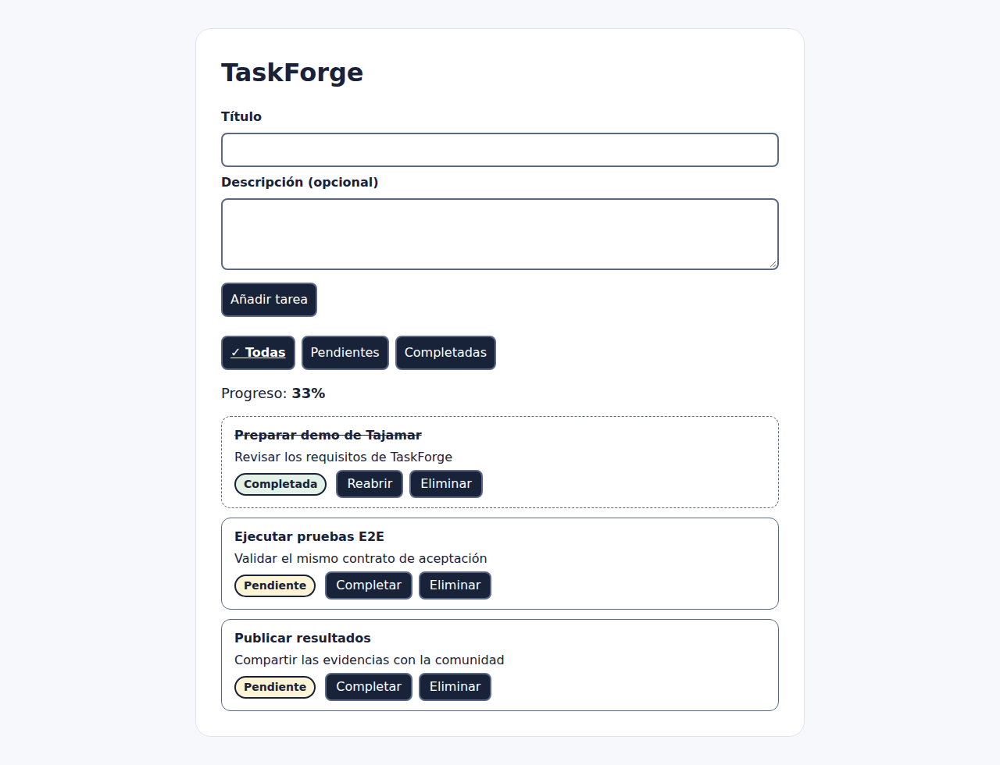
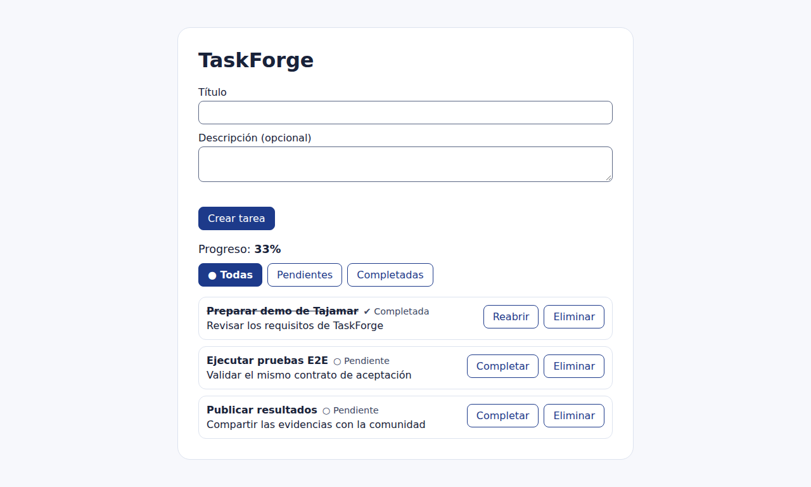

# ⚔️ Game of Prompts — GitHub Spec Kit vs GSD Core

[Español](README.md) · **English**

**One product requirements document. Two AI-assisted development workflows. Two working applications. Shared acceptance tests.**

Game of Prompts is an open, reproducible comparison of **GitHub Spec Kit** and **GSD Core**, implemented with GitHub Copilot CLI. Originally built for a 120-minute technical live demo at Tajamar (Spain), it is designed to be useful well beyond the event.

## Explore the evidence

| Resource | What it shows |
| --- | --- |
| [TaskForge requirements](docs/02-documento-funcional.md) | Shared functional requirements RF01–RF07 (Spanish) |
| [Spec Kit implementation](workspaces/jorge-speckit/) | Specification, plan, tasks and working app |
| [GSD Core implementation](workspaces/david-gsd/) | Roadmap, phases, plans and working app |
| [Live public dashboard](https://davidop.github.io/tajamar-game-of-prompts/) | Published, source-linked static comparison |
| [Shared Playwright tests](evaluation/) | Same end-to-end acceptance contract |
| [GitHub Actions](.github/workflows/quality.yml) | Automated tests and builds |
| [Learning guide](docs/19-continua-aprendiendo.md) | Independent follow-up exercise (Spanish) |

## Results from the reference CI run

| Check | Spec Kit | GSD Core |
| --- | ---: | ---: |
| Unit tests | 10/10 | 63/63 |
| Build | PASS | PASS |
| Shared Playwright E2E | 9/9 | 9/9 |

[Reference run](https://github.com/davidop/tajamar-game-of-prompts/actions/runs/44709353375). Unit test totals **cannot be compared directly** because the suites have different scope. This is a case study, **not a scientific benchmark**.


### Real screenshots of both applications

These images were generated by [Playwright in GitHub Actions](.github/workflows/capture-showcase.yml) using the same three-task scenario for both implementations. See the [evidence commit](https://github.com/davidop/tajamar-game-of-prompts/commit/61ea8c3db83faccb49a5ebd94dd23cdbff3c8066).





## Run the apps

Requirements: Git, Node.js 22+ and npm.

```bash
git clone https://github.com/davidop/tajamar-game-of-prompts.git
cd tajamar-game-of-prompts
npm ci --prefix workspaces/david-gsd
npm --prefix workspaces/david-gsd test
npm --prefix workspaces/david-gsd run build
npm --prefix workspaces/david-gsd run dev
```

Open http://127.0.0.1:5173. Stop the server before running the Spec Kit version:

```bash
npm ci --prefix workspaces/jorge-speckit
npm --prefix workspaces/jorge-speckit test
npm --prefix workspaces/jorge-speckit run build
npm --prefix workspaces/jorge-speckit run dev
```

To experiment with AI agents in isolated Git workspaces, run `npm run demo:prepare` from the repository root. Do not modify the published `workspaces/` snapshots.

## Who built it?

- **Jorge Fernández Sánchez**, Devoteam — Spec Kit — [LinkedIn](https://www.linkedin.com/in/jorgefdezsanchez/)
- **David Oliva Paredes**, knowmad mood — GSD Core — [LinkedIn](https://www.linkedin.com/in/davidolivaparedes/)

Jorge's official presentation is managed separately and will be added **after the session**. The `presentation/` directory contains older auxiliary HTML material, not Jorge's official deck.

## Help the project grow

If this experiment helped you, [⭐ star the repository](https://github.com/davidop/tajamar-game-of-prompts), share it with your team, or [open an issue](https://github.com/davidop/tajamar-game-of-prompts/issues/new/choose) with a reproducible bug or proposal. Read [CONTRIBUTING.md](CONTRIBUTING.md) before contributing. We welcome additional approaches, tests, accessibility improvements and documented replications, not winner claims unsupported by evidence.

MIT licensed. Not affiliated with the referenced framework maintainers.
