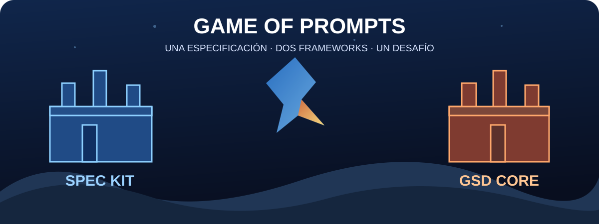

# ⚔️ Game of Prompts — Spec Kit vs GSD Core



**Tajamar · Sesión demostrativa de 120 minutos · GitHub Copilot CLI**

> **Una especificación. Dos metodologías. Dos implementaciones reales.**
> Jorge presenta **GitHub Spec Kit** y David presenta **GSD Core**.
> Los asistentes ven los artefactos, el código, los tests y la respuesta a un cambio de requisitos.
> **No es un workshop práctico:** el público no necesita instalar herramientas.

[](https://github.com/davidop/tajamar-game-of-prompts/actions/workflows/quality.yml)

## 👥 Conoce a los ponentes

| Ponente | Metodología | Perfil profesional |
| --- | --- | --- |
| **Jorge Fernández Sánchez** | GitHub Spec Kit | [LinkedIn de Jorge](https://www.linkedin.com/in/jorgefdezsanchez/) |
| **David Oliva Paredes** | GSD Core | [LinkedIn de David](https://www.linkedin.com/in/davidolivaparedes/) |

La presentación oficial la prepara Jorge fuera de este repositorio y se compartirá después de la sesión.

## 🎬 Empieza aquí: enseña el repo en 2 minutos

| Recurso | Qué enseñar |
| --- | --- |
| **[Presentación a pantalla completa](presentation/index.html)** | 10 diapositivas HTML, flechas para avanzar |
| **[PRD común de TaskForge](docs/02-documento-funcional.md)** | RF-01…RF-07 y contrato de pruebas |
| **[Jorge · Spec Kit](workspaces/jorge-speckit/)** | Especificación, plan, tareas, código y Vitest |
| **[David · GSD Core](workspaces/david-gsd/)** | Roadmap, 4 fases, 8 planes, código y node:test |
| **[Comparativa de métodos](docs/08-comparativa.md)** | Diferencias de proceso y trade-offs |
| **[Pruebas Playwright compartidas](evaluation/)** | Mismo contrato de aceptación para ambos |
| **[GitHub Actions](.github/workflows/quality.yml)** | Tests, builds y E2E de ambas implementaciones |
| **[Guion cronometrado](docs/16-sesion-demostrativa-120min.md)** | Qué muestra cada ponente y cuándo |
| **[Mostrar el repo en 5 minutos](docs/17-mostrar-repo-en-5-minutos.md)** | Recorrido exprés, enlaces y plan de contingencia |

**Abrir la presentación:** descarga o clona el repositorio y abre `presentation/index.html` en un navegador; usa ← y →. [Ver código de la presentación](presentation/index.html).

## ✅ Resultados verificados en GitHub Actions

| Comprobación | Spec Kit (Jorge) | GSD Core (David) |
| --- | ---: | ---: |
| Tests unitarios | **10/10** | **63/63** |
| Build Vite | **PASS** | **PASS** |
| Playwright E2E (PRD RF01–RF07) | **9/9** | **9/9** |

**Fuente:** [ejecución real del 20/11/2026, cinco jobs correctos](https://github.com/davidop/tajamar-game-of-prompts/actions/runs/44709043567). Los recuentos de tests unitarios **no son una métrica de calidad comparable por sí sola**: las suites tienen distinto alcance y granularidad. Consulta siempre el [estado de CI más reciente](https://github.com/davidop/tajamar-game-of-prompts/actions/workflows/quality.yml).

## 🗓️ Agenda de 120 minutos

| Minutos | Contenido | Ponente |
| --- | --- | --- |
| 00–10 | Prompting, SDD y reglas de comparación | Ambos |
| 10–20 | PRD TaskForge y contrato compartido | Ambos |
| 20–45 | Spec Kit: constitución, especificación, plan, tareas y app | Jorge |
| 45–70 | GSD Core: contexto, roadmap, fases, ejecución y app | David |
| 70–90 | Cambio de requisitos y análisis de impacto | Ambos |
| 90–105 | Builds, tests, Playwright y fallos observables | Ambos |
| 105–115 | Comparación técnica basada en evidencias | Ambos |
| 115–120 | Preguntas y conclusiones | Ambos |

## 🚀 Ejecutar ambas implementaciones

**Requisitos:** Node.js 22+ y npm. Los comandos siguientes se ejecutan desde la raíz del repo.

```bash
git clone https://github.com/davidop/tajamar-game-of-prompts.git
cd tajamar-game-of-prompts
npm run check

# David — GSD Core
npm ci --prefix workspaces/david-gsd
npm run test:gsd
npm --prefix workspaces/david-gsd run build
npm --prefix workspaces/david-gsd run dev
```

Para mostrar la versión de Jorge, detén el servidor anterior y ejecuta:

```bash
npm ci --prefix workspaces/jorge-speckit
npm run test:speckit
npm --prefix workspaces/jorge-speckit run build
npm --prefix workspaces/jorge-speckit run dev
```

Las dos apps usan `http://127.0.0.1:5173`; **solo una puede estar levantada a la vez en el mismo equipo**.

### Pruebas de aceptación reales (Playwright)

```bash
npm ci --prefix evaluation
cd evaluation
npx playwright install chromium
# Playwright arranca Vite automáticamente y lo detiene al terminar:
npm test
```

Por defecto prueba **GSD Core**. Para probar **Spec Kit**, desde PowerShell:

```powershell
$env:TASKFORGE_WORKSPACE="workspaces/jorge-speckit"
npm test
```

En GitHub Actions se prueban **las dos implementaciones por separado**. Un badge verde solo representa los checks efectivamente ejecutados en la última ejecución, no un benchmark científico.

## 🛡️ Ensayar con Git independiente y sin tocar main

Los dos directorios de `workspaces/` son **snapshots versionados** para enseñar el resultado, no repositorios Git anidados. Para ejecutar GSD o Spec Kit y crear commits durante la demo, usa copias aisladas:

```bash
npm run demo:prepare
cd demos/david-gsd
git rev-parse --show-toplevel
npm ci
npm run dev
```

Se crean `demos/david-gsd` y `demos/jorge-speckit`, cada uno con **su propio Git y un commit inicial**. La operación no sobrescribe copias existentes. **No recupera el historial original de commits del ensayo**; el historial de fases de GSD está documentado en `.planning/`. Los directorios `demos/` están ignorados por Git.

Para **empezar desde el starter vacío** en lugar de usar las implementaciones completas, utiliza `npm run setup -- --framework gsd --name nuevo-gsd` o `--framework spec-kit --name nuevo-speckit`. Usa nombres nuevos: los snapshots publicados ya ocupan `david-gsd` y `jorge-speckit`.

## 📚 Artefactos y trazabilidad

- [GSD · planificación y auditoría del milestone v1.0](workspaces/david-gsd/.planning/milestones/v1.0-MILESTONE-AUDIT.md).
- [Spec Kit · especificación, plan y tareas](workspaces/jorge-speckit/specs/001-taskforge-mvp/).
- [Guía de David](docs/14-ensayo-david-gsd.md) y [guía de Jorge](docs/15-ensayo-jorge-speckit.md).
- [Preparación conjunta y protocolo de ensayo](docs/13-ensayo-ponentes.md).

**Material reservado:** el texto y las pruebas del cambio sorpresa se comparten entre ponentes **fuera del repositorio público**. No subirlos antes de la sesión.

**Referencias:** [GitHub Spec Kit](https://github.com/github/spec-kit) · [GSD Core](https://github.com/open-gsd/gsd-core) · [GitHub Copilot CLI](https://docs.github.com/es/copilot/how-tos/copilot-cli/set-up-copilot-cli/install-copilot-cli).

Contenido propio bajo [MIT](LICENSE). Sesión independiente de los proyectos citados.
